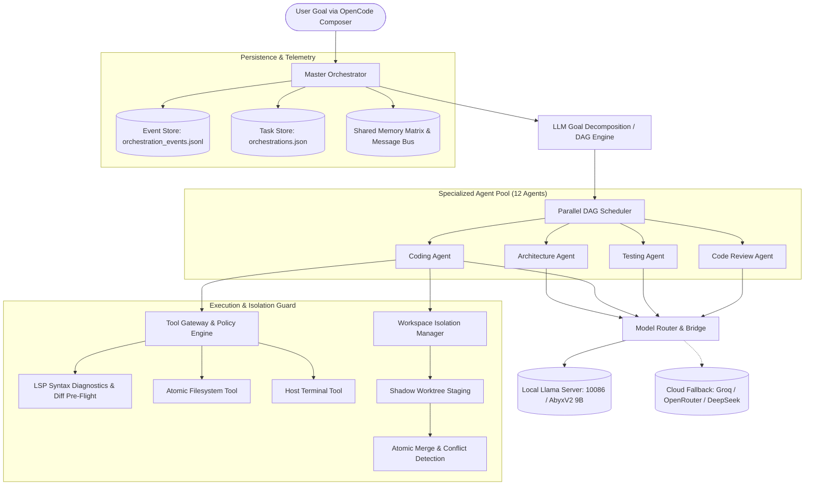

# ABYX UNIFIED AI STUDIO — ARCHITECTURE AND IMPLEMENTATION BLUEPRINT

## 1. System Architecture Overview

Abyx Unified AI Studio is designed as a production-grade multi-agent software engineering harness. The system is split into two primary planes:
1. **Control & Inference Plane:** Coordinates task decomposition, rolling parallel DAG scheduling, specialized agent execution loops, and inter-agent communication.
2. **Execution & Isolation Plane:** Enforces policy controls, workspace path guards, shadow worktree staging, atomic merges, pre-flight LSP validation, and independent verification.

---

## 2. Core Subsystems

### 2.1 Model Router & Real Inference Bridge
**File:** [model_router.js](file:///C:/Users/abira/Documents/Local%20Ai%20studio%20Abyx/agent/model_router.js)

- **Local Endpoint:** Connects to `http://127.0.0.1:10086/v1/chat/completions` (OpenAI compatible).
- **Thinking Model Parser:** Accommodates models like `AbyxV2 9B.gguf` which emit reasoning traces in `choice.message.reasoning_content`. When token limits truncate standard content, the parser inspects `reasoning_content` to extract solutions and JSON action blocks.
- **Dynamic Parameter Bridging:** Directly controls:
  - `systemPrompt`: Customizable agent identity.
  - `contextSize`: 0 (model default) up to 262,144 tokens with RoPE frequency scaling.
  - `temperature`: Configurable from 0.0 to 1.5.
  - `maxResponseTokens`: Dynamic budget (2048 to 4096 tokens) preventing premature truncation during reasoning.
  - `seed`: Fixed seed for reproducible workflows or -1 for stochastic exploration.
  - `performanceProfile`: Potato, Balanced, High, or Custom.
  - `textBackend`: CUDA, Vulkan, or CPU-only execution.
  - `cpuThreads`, `gpuLayers`, `batchSize`, and `kvCache` (Q4_0, Q8_0, F16).
- **Cloud Fallback:** Queries DPAPI-encrypted credential vault for Groq, OpenRouter, and DeepSeek when local endpoints are unreachable.

### 2.2 Orchestrator & Task Scheduler
**Files:** [orchestrator.js](file:///C:/Users/abira/Documents/Local%20Ai%20studio%20Abyx/agent/orchestrator.js), [scheduler.js](file:///C:/Users/abira/Documents/Local%20Ai%20studio%20Abyx/agent/scheduler.js)

- **DAG Cycle Prevention:** Enforces strict Kahn's algorithm or depth-first cycle checks prior to scheduling. Circular dependencies (e.g., A -> B -> A) are rejected at validation time.
- **Rolling Concurrency:** Bounded worker pool (1 to 8 workers, default 4). Independent subtasks with satisfied dependencies execute concurrently without artificial sleeps.
- **Cancellation & Abort Signals:** Clean termination cascades through active tasks via `AbortController`.

### 2.3 Autonomous Multi-Turn Tool Execution
**Files:** [orchestrator.js](file:///C:/Users/abira/Documents/Local%20Ai%20studio%20Abyx/agent/orchestrator.js), [tool_gateway.js](file:///C:/Users/abira/Documents/Local%20Ai%20studio%20Abyx/agent/tool_gateway.js)

Specialized agents execute autonomous loops up to their bounded step limit (`maxSteps` 5–10):
1. **Prompt Construction:** Injects task description, allowed tools, and predecessor findings from shared memory.
2. **Turn Inference:** Calls `modelRouter.generateResponse()`.
3. **Action Extraction:** Detects both native OpenAI `tool_calls` and structured JSON actions (`{"tool": "fs_write", "args": {...}}`).
4. **Pre-flight LSP Check:** For code edits, validates proposed diffs via `lsp_validate_diff` to reject syntax or delimiter errors before disk writes.
5. **Tool Execution:** Executes through `ToolGateway` with policy enforcement and audit recording.
6. **Context Re-injection:** Feeds tool results back into conversation turns until the task goal is satisfied.

### 2.4 Workspace Isolation & Reconciler
**File:** [workspace_isolation.js](file:///C:/Users/abira/Documents/Local%20Ai%20studio%20Abyx/agent/workspace_isolation.js)

- **File Ownership Locks:** Exclusive write locks prevent simultaneous modifications of the same source files across parallel agents.
- **Shadow Staging:** Agent modifications are written to temporary staging copies.
- **Atomic Reconciliation:** On task completion, staged files are verified and atomically merged into the approved workspace.

### 2.5 Persistent Shared Memory & Event Store
**Files:** [shared_memory.js](file:///C:/Users/abira/Documents/Local%20Ai%20studio%20Abyx/agent/shared_memory.js), [event_store.js](file:///C:/Users/abira/Documents/Local%20Ai%20studio%20Abyx/agent/event_store.js), [task_store.js](file:///C:/Users/abira/Documents/Local%20Ai%20studio%20Abyx/agent/task_store.js)

- **Dependency Context Passing:** Downstream agents automatically receive concise, token-bounded outputs from completed prerequisites.
- **Findings Matrix:** Records technical decisions, architecture contracts, and deliverables.
- **Append-Only JSONL Event Stream:** Persists every lifecycle event (`orchestration:started`, `task:tool_call`, `task:completed`) to `app/data/orchestration_events.jsonl`.
- **DAG Run Persistence:** Persists full orchestration reports to `app/data/orchestrations.json`.
