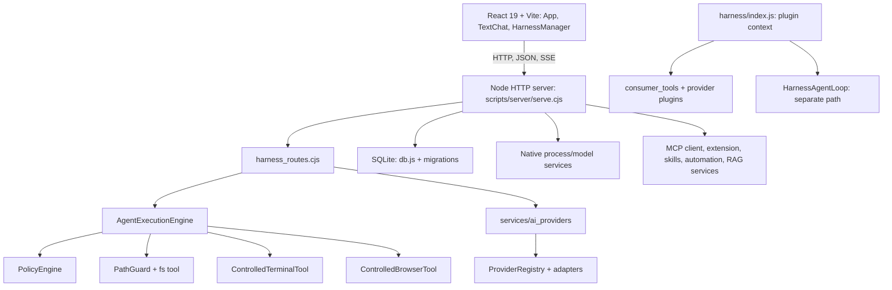

# Abyx Existing Architecture

## System map

## Lifecycle and data flow

`Abyx.bat`/platform scripts launch the Node server and managed local inference processes. `scripts/server/serve.cjs` initializes routes, services and an HTTP server bound to `127.0.0.1` unless a host override is supplied. The React entry is `app/frontend/src/main.jsx`; `App.jsx` mounts navigation and feature surfaces, and `services/api.js` owns fetch/Tauri calls. Chat flows through legacy chat endpoints in the large server module; the harness view uses `/api/agent/stream` and SSE events. That route gets a cached `AgentExecutionEngine` per profile/workspace, creates a `buildStepExecutor`, calls `services/ai_providers.streamProviderChat`, parses a JSON action, then invokes engine tool authorization/execution. `AgentExecutionEngine.run()` maintains a bounded in-memory run and timeline and `ExecutionLogger` persists scrubbed run records.

In parallel, `harness/index.js` mounts filesystem, sandbox, memory, browser, subagent, model and terminal plugins plus `consumer_tools`. `HarnessAgentLoop.runTurn()` has its own provider path, Ollama streaming, direct consumer tool dispatch and JSON session file store. Main route references do not invoke `HarnessAgentLoop`; harness status/plugin endpoints inspect the static plugin registry. This is capability duplication, not a single runtime.

Provider selection is split between `providers/registry.js`, adapter classes, `services/ai_providers.js`, local runtime management and settings/config files. SQLite operations and schema evolution live in `db.js`/`db_migrations.js`; other state is persisted as JSON under data/profile/workspace locations. RAG uses parsing/chunking/embeddings and SQLite-backed `KnowledgeService`; MCP configuration and tool calls are in `services/mcp_client.js`; extensions are installed/validated/executed by `extensions/*`; automation uses `automations/*` and `services/automation_service.js`.

## Important boundaries and caveats

- Agent profile is hardcoded to `prof_default` inside harness route handling; workspace is active global state. The engine cache key includes profile, workspace ID and path but profiles are not selected from the request.
- `PathGuard` checks model paths and tool operations but does not confine shell commands at the OS level. Browser and filesystem routes elsewhere in `serve.cjs` are separate boundaries and require their own review.
- The engine's run registry is process memory; persisted run JSON is the recovery/history path. The second session store is synchronous JSON append-by-read/rewrite and is separate.
- Context telemetry/compaction endpoints exist. Static use shows estimated token counts and a heuristic truncation summary, not tokenizer-backed or model-integrated automatic compaction.
- Frontend screenshots and README describe intended product scope; status labels in UI are not execution evidence.

Main references: `agent/index.js`, `agent/execution_loop.js`, `scripts/server/harness_routes.cjs`, `harness/index.js`, `harness/agent_seam.js`, `services/ai_providers.js`, `providers/registry.js`, `services/context_manager.js`, `db.js`, `scripts/server/serve.cjs`.
