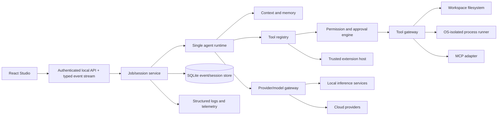

# Recommended Architecture



## Responsibilities and interfaces

**API/job service:** validate workspace/session/provider references; create jobs; expose typed SSE; handle auth, origin, disconnect and rate limits. **Runtime:** own state machine, budget, plan/action cycle, cancellation and completion; emit immutable `RunEvent`s. **Provider gateway:** normalized request, capability descriptor and async stream of `text_delta`, `reasoning`, `tool_call`, `usage`, `error`, `done`; retries only on classified idempotent failures. **ToolRegistry:** versioned schema + executor + side-effect class + permission declaration + provenance. **Permission engine:** policy decision over user/session/workspace/tool/resource, default-deny unknown capabilities, approval bound to immutable argument hash. **Tool gateway:** sole execution route, argument/result validation, timeout, output bounds, event logging and cancellation. **Filesystem/terminal:** use canonical workspace handles and OS sandbox, never infer isolation from cwd. **MCP/extension host:** per-server/package identity, trust status, lifecycle and least privilege. **Context/memory:** typed conversation events, tokenizer-aware budget, compacted summary provenance, RAG source IDs. **Session store:** versioned append-only event records plus periodic snapshots; unique IDs and recovery. **Observability:** correlated request/run/step/tool/provider IDs with secret redaction and retention.

## Directory direction

```text
agent/ runtime/ (loop, state, events, budgets)
providers/ (contracts, registry, adapters)
tools/ (registry, gateway, builtins, mcp)
security/ (policy, approvals, sandbox, credentials)
sessions/ (schema, repository, compaction)
context/ (tokenization, memory, retrieval)
jobs/ (automation, lifecycle, artifacts)
extensions/ (manifest, trust, host)
api/ (routes, schemas, auth)
app/frontend/src/ (feature routes, shared run components)
```

This is a responsibility map, not a directive to change languages or replace existing folders wholesale. Implement security boundaries first; retain media/model services as adapters. Never load an extension or execute code in-process while advertising it as sandboxed. Failure scenarios to design for include provider timeout, malformed tool JSON, approval timeout, crash during event persistence, process orphaning, MCP disconnection and workspace switch during a run.
