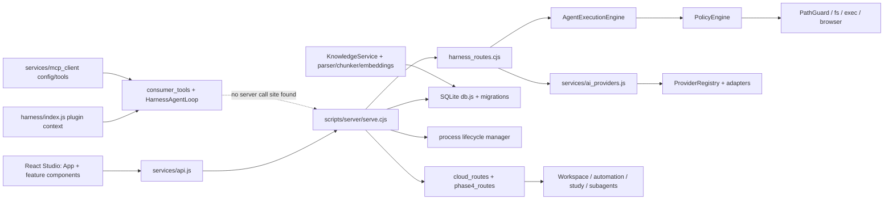

# Existing Architecture (Current Working Tree)

## Active server and user flows

`Abyx.bat`, `windows.bat`, `linux.sh` and `mac.sh` are launch/packaging entry points. `scripts/server/serve.cjs` initializes SQLite, provider/workspace services, route modules, and model/media process state. It binds loopback by default; `ABYX_HOST`/`UAIS_HOST` can widen binding. JSON/CORS helpers currently allow `*`, including requests to high-impact local APIs. `app/frontend/src/main.jsx` mounts React; `App.jsx` routes Sidebar-selected studio views; `services/api.js` is a large HTTP/Tauri façade. Normal chat/model/media flows are implemented in the long server module and provider services. Harness UI calls agent endpoints under `scripts/server/harness_routes.cjs`.

## Active coding-agent execution path

`POST /api/agent/stream` parses request, creates SSE response, gets runtime keyed by profile/workspace, builds a step callback, and calls `AgentExecutionEngine.run`. That loop increments step count, calls the model through `aiProviders.streamProviderChat`, parses JSON tool selection and dispatches via `requestAndExecuteTool`; that method applies `PolicyEngine`, waits for approval if needed, invokes `Controlled*Tool`, emits timeline and persists terminal run JSON. `POST /api/agent/run` reuses the executor without SSE. `POST /api/terminal/execute` separately classifies policy and then runs shell; its behavior is a distinct path that needs the same strict policy. Workspace CRUD/file APIs in `cloud_routes.cjs` use a PathGuard/WorkspaceFsTool, outside agent approvals but in a UI-managed path.

## Implemented but disconnected or duplicated paths

- `harness/index.js` mounts custom EventEmitter plugins and exports `HarnessAgentLoop`. Search found no route call to `runTurn`; active server uses `AgentExecutionEngine`.
- `consumer_tools.js` creates one tool schema table and dispatch tree separate from agent dispatch. It is consumed by the disconnected loop.
- `services/mcp_client.js` and phase4 routes expose server configuration/status. Configured external tool schemas are appended, but the client dispatch recognizes only three built-in local tools; no remote MCP transport was found.
- `extensions/index.js` creates `PluginRunner`, which loads module code using `require`; no active server integration call site was found in the inspected tree.
- Context/session artifacts are split across SQLite chat, `ExecutionLogger` per-run JSON and a separate synchronous `HarnessSessionStore` JSON file.

## Other subsystems

Providers are adapter classes in `providers/`, catalog/routing in `ProviderRegistry`, and a second compatibility/failover path in `services/ai_providers.js`. SQLite migrations cover chat, memory, provider credentials, knowledge sources/chunks, studybooks and usage. RAG parses/chunks documents, embeds chunks and stores text/embeddings in SQLite/FTS. `services/workspace_service.js` keeps active workspace metadata in JSON and supports external roots. `automations/` stores workflows and runs interval scheduling; `services/subagents.js` sends prompts to a model endpoint rather than isolating execution. Media workers and model backends are child processes; process manager is active for LLM/backend and terminal jobs, not proven unified for every worker.

## Important data and identity boundaries

Harness routes hardcode `profileId = prof_default`; active workspace is process-global. Current user state includes a dirty working tree and untracked test fixture. Do not build baseline artifacts in `test/temp_workspace` or rebuild `app/dist`. Permission checks in `AgentExecutionEngine` are not automatically inherited by arbitrary direct HTTP file APIs, MCP, extensions or other services; those paths need an explicit user/API security model.
