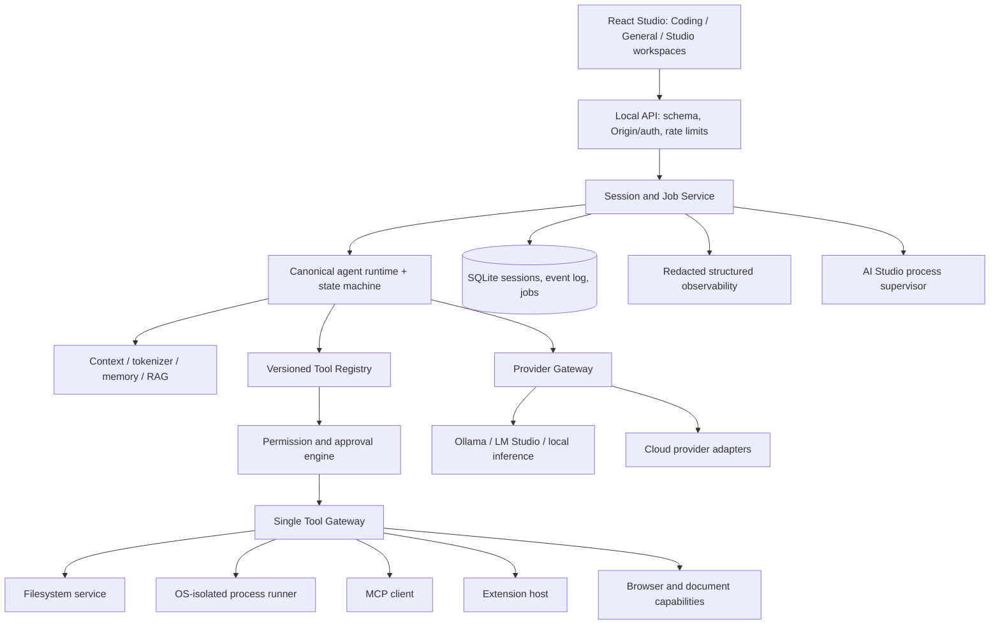

# Target Architecture

## Ownership and interfaces

1. **API boundary:** validates versioned JSON input; binds requests to profile/workspace/session; enforces Origin/Host/auth policy; owns SSE lifecycle. It does not contain model policy or direct tool logic.
2. **Session/Job Service:** creates canonical `Session`, `Run`, `Job`, `Artifact` identities; owns persistence, cancellation, resume, queueing and shutdown. Run ownership must remain explicit across workspace changes.
3. **Agent Runtime:** a single implementation for chat-with-tools and autonomous tasks. Input is `RunRequest`; output is an ordered `RunEvent` stream and final outcome. It controls budgets, loop state and completion; it never executes a tool directly.
4. **Provider Gateway:** `ModelDescriptor` capabilities and a normalized stream (`text_delta`, `reasoning_delta`, `tool_call_delta`, `usage`, `error`, `done`). Owns provider auth references, cancellation, structured retries and fallback trace.
5. **Tool Registry/Gateway:** registration schema includes stable ID/version, JSON schema, executor, permissions, risk, provenance and timeout. One gateway validates arguments/results, checks policy, binds approval to call hash, supplies AbortSignal, bounds output and emits audit events.
6. **Permission Engine:** default-deny unknown action; policy over actor, workspace, tool, target and exact arguments. Approval once vs session grant is distinct and revocable. UI confirmation does not replace OS isolation.
7. **Filesystem/process:** canonical workspace root, no-follow path operations and conflict-aware staged diffs. Arbitrary shells/code run in OS-level disposable boundaries; cwd alone is never called a sandbox.
8. **Context/memory/RAG:** typed history with tool call/result pairing, provider-aware token budgets, summary provenance and source-index lifecycle. User memory is distinct from retrieval corpus and transcript.
9. **MCP/extensions/skills:** actual MCP protocol connection and server-qualified tool identities. Extensions are trusted code unless separately hosted; skills are declarative instruction/data packages and do not silently gain tool rights.
10. **AI Studio supervisor:** one process registry/health API for LLM, speech, image, video and TTS workers, with identity verification, budgets and scoped shutdown. Optional media failures cannot corrupt chat/session state.

## Existing module disposition

Preserve `db.js`/migrations (evolve additively), provider adapters, modality services, workspace service, parser/chunker, useful UI screens and brand. Refactor `harness_routes.cjs` into thin versioned endpoints; consolidate `AgentExecutionEngine` and the disconnected `HarnessAgentLoop`; make `consumer_tools` an adapter to a shared registry. Harden/replace process execution and `PathGuard`; replace config-only MCP claims with a real transport. Retire duplicate per-run/session storage only after migration/export and recovery tests. Do not rewrite React, SQLite, providers or media stack without measured evidence.
