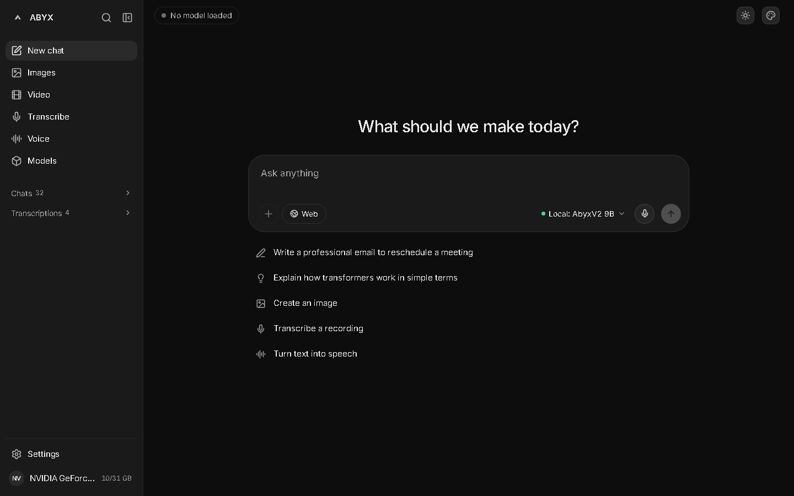
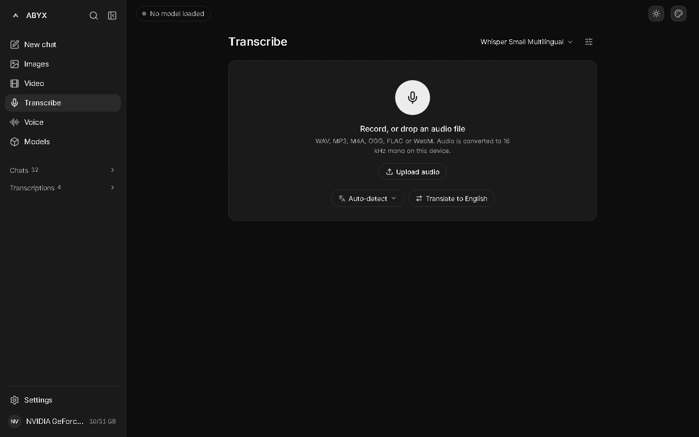
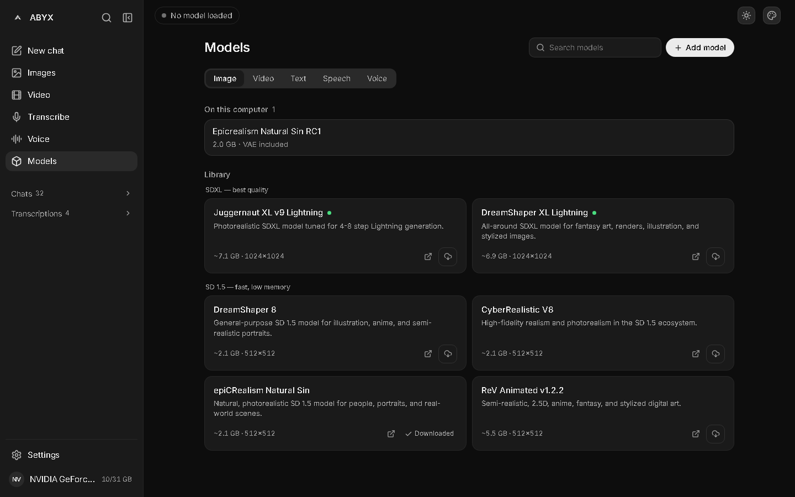

<p align="center">
  
</p>

<h1 align="center">Abyx Studio</h1>

<p align="center">
  <strong>The all-in-one local & cloud AI workstation for Autonomous Agents, LLM Chat, Image Generation, Speech-to-Text, and Neural Voice Synthesis.</strong>
</p>

<p align="center">
  <a href="#license"></a>
  <a href="#getting-started"></a>
  <a href="#hardware-acceleration"></a>
  <a href="#getting-started"></a>
  <a href="https://github.com/Abyxen/Abyx-Studio"></a>
</p>

---

## 📸 Overview & Interface

<p align="center">
  
  <br />
  <sub><strong>Abyx Text & Code Workspace:</strong> Live streaming, DeepThink reasoning indicators, autonomous code generation, and live app execution.</sub>
</p>

<table>
  <tr>
    <td width="50%" align="center">
      
      <br /><sub><strong>Image Studio:</strong> Offline Stable Diffusion generation and prompt gallery.</sub>
    </td>
    <td width="50%" align="center">
      
      <br /><sub><strong>Speech to Text:</strong> Real-time local Whisper audio transcription.</sub>
    </td>
  </tr>
  <tr>
    <td width="50%" align="center">
      
      <br /><sub><strong>Voice Synthesis:</strong> Lifelike neural speech powered by Kokoro TTS.</sub>
    </td>
    <td width="50%" align="center">
      
      <br /><sub><strong>Model Hub:</strong> One-click local model management and Hugging Face imports.</sub>
    </td>
  </tr>
</table>

---

## 📖 Table of Contents
* [What is Abyx Studio?](#what-is-abyx-studio)
* [Key Capabilities](#key-capabilities)
* [System Architecture](#system-architecture)
* [Getting Started (Zero Configuration)](#getting-started)
  * [Windows Quickstart](#windows-quickstart)
  * [Linux Quickstart](#linux-quickstart)
  * [macOS Quickstart](#macos-quickstart)
* [Hardware Acceleration](#hardware-acceleration)
* [Recommended Models](#recommended-models)
* [Hybrid Cloud Routing](#hybrid-cloud-routing)
* [Project Directory Layout](#project-directory-layout)
* [Troubleshooting & FAQ](#troubleshooting--faq)
* [Contributing & License](#license)

---

## 🌟 What is Abyx Studio?

**Abyx Studio** is an open-source, zero-configuration desktop AI workstation engineered for developers, researchers, and creators. It unifies high-performance local AI engines with an autonomous agentic framework, giving you full conversational AI, code execution, image creation, speech recognition, and neural voice synthesis—completely private, offline, and subscription-free.

When you need massive multi-modal reasoning beyond local hardware limits, Abyx Studio seamlessly routes queries to top-tier cloud models (Google Gemini 2.0, Claude 3.5/3.7, DeepSeek-R1, OpenAI o3-mini) using your own free or custom API keys.

---

## 🚀 Key Capabilities

### 1. 💬 Conversational Chat & Autonomous Coding Agent
* **High-Speed GGUF Inference:** Powered by an optimized, hardware-accelerated `llama.cpp` server backend.
* **Server-Sent Events (SSE):** Smooth, ultra-low latency token streaming directly into a responsive modern interface.
* **DeepThink Status Tracking:** Real-time dynamic activity pills reflecting what the agent is doing (`Thinking…`, `Writing calculator.html…`, `Synthesizing audio…`, `Generating image…`).
* **Contextual File Creation:** Automatically extracts generated code into designated files and names them intelligently based on conversation context (no more overwriting `index.html`).
* **In-App Browser (`local://`):** Preview and test generated HTML5 web applications, dashboards, simulations, and games instantly inside the studio window.

### 2. 🎨 Stable Diffusion Image Studio
* **Native C++ Execution:** Powered by `stable-diffusion.cpp` with dedicated CUDA and Vulkan backends.
* **Format Flexibility:** Load `.safetensors`, `.gguf`, or `.ckpt` weights (SD 1.5, SDXL, DreamShaper, CyberRealistic).
* **Creative Controls:** Customize negative prompts, sampling steps, CFG scale, seed control, and resolution presets.
* **Integrated Gallery:** View past generations with prompt parameters, timestamps, and generation seeds saved alongside each output.

### 3. 🎙️ Local Speech Transcription (Whisper)
* **Private Voice Dictation:** Integrated `whisper.cpp` engine converts voice notes and microphone recordings into text with zero cloud dependency.
* **Multi-Language Support:** Auto-detects spoken languages or accepts explicit translation requests.

### 4. 🗣️ Neural Text-to-Speech (Kokoro TTS)
* **Human-Grade Voice Synthesis:** Driven by the `Kokoro-82M` ONNX model for natural, emotional vocal delivery.
* **In-Chat Audio Player:** Play synthesized audio directly inside chat bubbles, view progress waveforms, and reveal audio files directly in Windows Explorer / Finder.

### 5. 🧠 Living Memory & Persistent Knowledge
* **Embedded SQLite Database:** Stores chat sessions, project logs, hardware telemetries, and long-term user memories without requiring external database setups.
* **Autonomous Directive Interceptor:** Detects inline triggers like `[IMAGE: ...]` and `[AUDIO: ...]` to generate multimedia assets autonomously during conversation.

---

## 🏗️ System Architecture

Abyx Studio separates heavy neural computation into isolated native processes managed by an asynchronous Node.js coordination daemon, ensuring that GPU operations never block the frontend interface:

```
┌─────────────────────────────────────────────────────────────────────────┐
│                           ABYX STUDIO FRONTEND                          │
│          React 19  •  Vite  •  Lucide Icons  •  KaTeX  •  SSE           │
└────────────────────────────────────┬────────────────────────────────────┘
                                     │ HTTP / Server-Sent Events (Port 1420)
┌────────────────────────────────────▼────────────────────────────────────┐
│                    NODE.JS ORCHESTRATION DAEMON                         │
│   Process Supervision  •  Directive Parsers  •  SQLite  •  Cloud Hub    │
└──────────┬──────────────────┬──────────────────┬─────────────────┬──────┘
           │                  │                  │                 │
    (Child Process)    (Child Process)    (Child Process)   (Child Process)
           │                  │                  │                 │
┌──────────▼────────┐┌────────▼────────┐┌────────▼────────┐┌───────▼──────┐
│     llama.cpp     ││stable-diffusion ││   whisper.cpp   ││  Kokoro TTS  │
│  LLM Engine GGUF  ││ Image Generator ││ Speech-to-Text  ││ Neural Voice │
│ (CUDA / Vulkan)   ││ (CUDA / Vulkan) ││ (AVX2 / CUDA)   ││(ONNX Runtime)│
└───────────────────┘└─────────────────┘└─────────────────┘└──────────────┘
```

---

## ⚡ Getting Started (Zero Configuration)

Abyx Studio requires **no pre-installed Node.js, Python, or complex dependencies**. Everything is bootstrapped automatically on first launch.

### Windows Quickstart
1. Clone the repository:
   ```cmd
   git clone https://github.com/Abyxen/Abyx-Studio.git
   cd Abyx-Studio
   ```
2. Double-click **`Abyx.bat`** (or run `Abyx.bat` from terminal).
3. The automated setup will:
   - Check and verify your GPU drivers and Visual C++ Redistributables.
   - Install a self-contained portable Node.js toolchain into `app/tools/`.
   - Download the matching hardware acceleration backends.
   - Compile the frontend build into `app/dist/`.
   - Automatically launch the workstation at **`http://localhost:1420`**.

### Linux Quickstart
1. Clone the repository:
   ```bash
   git clone https://github.com/Abyxen/Abyx-Studio.git
   cd Abyx-Studio
   ```
2. Launch the studio:
   ```bash
   chmod +x linux.sh
   ./linux.sh
   ```

### macOS Quickstart
1. Clone the repository:
   ```bash
   git clone https://github.com/Abyxen/Abyx-Studio.git
   cd Abyx-Studio
   ```
2. Launch with Metal acceleration:
   ```bash
   chmod +x mac.sh
   ./mac.sh
   ```

---

## 🎮 Hardware Acceleration

Abyx Studio inspects your system hardware upon launch and initializes the best runtime:

| Vendor | Platform | Accelerated Backend | Supported Hardware |
| :--- | :--- | :--- | :--- |
| **NVIDIA** | Windows / Linux | **CUDA 12.8 / cuBLAS** | RTX 50-series (Blackwell), RTX 40/30/20-series, GTX 16-series |
| **AMD** | Windows / Linux | **ROCm / Vulkan** | Radeon RX 7000/6000-series, ROG Ally, Steam Deck |
| **Intel** | Windows / Linux | **Vulkan / OpenVINO** | Intel Arc A-Series GPUs, Intel Core Ultra NPUs |
| **Apple** | macOS | **Metal Performance Shaders** | Apple Silicon M1, M2, M3, M4 (Pro, Max, Ultra) |
| **Universal** | All | **CPU (AVX2 / AVX-512)** | Any x86_64 or ARM64 processor |

---

## 🧠 Recommended Models

All local text models must be in **GGUF format** and placed into [app/llm-models/](app/llm-models/):

| Model | Size (Q4_K_M) | Recommended Hardware | Primary Strength |
| :--- | :--- | :--- | :--- |
| **Qwen 2.5 Coder 7B Instruct** | ~4.7 GB | 8 GB VRAM (RTX 3060/4060/5060) | **Best-in-class coding agent**, HTML5/JS games, tools. |
| **DeepSeek-R1-Distill-Qwen-8B** | ~5.1 GB | 8 GB VRAM | **Deep chain-of-thought reasoning**, math, architecture. |
| **Llama 3.1 8B Instruct** | ~4.9 GB | 8 GB VRAM | High-speed creative writing, dialogue, structured JSON. |
| **Gemma 2 9B Instruct** | ~5.5 GB | 8 GB VRAM | High factual precision, analytical Q&A. |
| **Qwen 2.5 Coder 14B (Q3_K_M)** | ~7.5 GB | 8 GB - 12 GB VRAM | Near GPT-4 level software engineering locally. |

> [!TIP]
> Download any GGUF directly from Hugging Face into `app/llm-models/`, and it will immediately appear in the model selector dropdown inside Abyx Studio.

---

## 🌐 Hybrid Cloud Routing

Need massive multi-file coding or multi-modal analysis that exceeds your local GPU? Abyx Studio includes a built-in Cloud AI Router:

1. In Abyx Studio, click **⚙️ Configure Cloud Providers**.
2. Add your API keys (stored safely in local memory):
   * **Google Gemini** (Free tier available on Google AI Studio — *Gemini 2.0 Flash / Pro*)
   * **OpenRouter** (Unified access to *Claude 3.5/3.7 Sonnet*, *DeepSeek-R1 671B*, etc.)
   * **Anthropic** (*Claude 3.5 Sonnet / Haiku*)
   * **Groq** (Ultra-fast cloud inference)
   * **OpenAI** (*GPT-4o, o3-mini*)
3. Switch between local offline inference and cloud super-intelligence seamlessly from the model selector.

---

## 📁 Project Directory Layout

```
Abyx-Studio/
├── Abyx.bat                   # Windows 1-Click Launch & Setup
├── linux.sh                   # Linux Terminal Entrypoint
├── mac.sh                     # macOS Metal Entrypoint
├── LICENSE                    # MIT Open Source License
├── .gitignore                 # Production ignore list (protects private data & weights)
├── README.md                  # Comprehensive Documentation
├── agent/                     # Autonomous agent logic, loop supervisors & tools
├── app/
│   ├── frontend/              # Modern React 19 + Vite frontend source code
│   │   ├── src/components/    # TextChat, Generator, ModelManager, Speech, Voice
│   │   └── package.json       # UI dependencies
│   ├── dist/                  # Precompiled production frontend build
│   ├── config/                # Runtime inference settings and context limits
│   ├── models/                # Local Stable Diffusion weights (.safetensors)
│   ├── llm-models/            # Local LLM weights (.gguf)
│   ├── speech-models/         # Local Whisper speech weights (.bin)
│   └── tts-models/            # Local Kokoro neural voice weights
├── automations/               # Scheduled workflows and routine tasks
├── docs/                      # Screenshots, branding, and guides
├── extensions/                # Pluggable capabilities and tooling modules
├── harness/                   # Sandbox environment for code execution & testing
├── providers/                 # API client adapters for cloud providers
├── rag/                       # Local retrieval-augmented generation engine
├── scripts/
│   ├── server/serve.cjs       # Core Node.js backend orchestrator & daemon
│   ├── setup/setup.ps1        # Windows automated bootstrapper & runtime installer
│   ├── setup/setup.sh         # Linux/macOS bootstrapper
│   └── build/                 # Source build tools for CUDA/Vulkan backends
├── security/                  # Path guards, input sanitation & execution policies
├── services/                  # Memory, skills, and background workers
└── skills/                    # Specialized AI agent skills library
```

---

## 🔧 Troubleshooting & FAQ

<details>
  <summary><strong>Windows exits with code <code>3221225781</code> (0xC0000135)</strong></summary>
  <p>This code indicates a missing system DLL. Run <code>scripts/setup/setup.ps1</code> or download and install the official <a href="https://aka.ms/vc14/vc_redist.x64.exe">Microsoft Visual C++ 2015-2022 Redistributable (x64)</a>, restart Windows, and relaunch <code>Abyx.bat</code>.</p>
</details>

<details>
  <summary><strong>Model fails to load: <code>unknown model architecture: 'inkling2_loop'</code></strong></summary>
  <p>Models using experimental custom architectures (like Inkling 2 Looped MoE) require specialized layer-unrolling patches not yet in standard llama.cpp releases. For best results, use standard transformer architectures such as <strong>Qwen 2.5</strong>, <strong>Llama 3.1</strong>, <strong>Mistral</strong>, or <strong>Gemma 2</strong>.</p>
</details>

<details>
  <summary><strong>How do I change the default port?</strong></summary>
  <p>Abyx Studio runs on port 1420 by default. To change it, set the environment variable before starting:</p>
  <pre><code>set FRONTEND_PORT=3000
Abyx.bat</code></pre>
</details>

<details>
  <summary><strong>How do I share Abyx across my local network (LAN)?</strong></summary>
  <p>Set <code>UAIS_HOST=0.0.0.0</code> in your environment before starting Abyx to bind to all network interfaces.</p>
</details>

---

## 📄 License

This project is open-source and licensed under the [MIT License](LICENSE).

### Acknowledgments & Ecosystem
Abyx Studio is made possible thanks to the open-source AI community:
* [llama.cpp](https://github.com/ggerganov/llama.cpp) by Georgi Gerganov & contributors.
* [stable-diffusion.cpp](https://github.com/leejet/stable-diffusion.cpp) by Leejet & contributors.
* [whisper.cpp](https://github.com/ggerganov/whisper.cpp) by Georgi Gerganov.
* [Kokoro-82M](https://huggingface.co/hexgrad/Kokoro-82M) by Hexgrad & [kokoro-js](https://github.com/taylorchu/kokoro-js).
* [React](https://react.dev/) & [Vite](https://vite.dev/).

---

<p align="center">
  <strong>Built with precision by <a href="https://github.com/Abyxen">Abyxen</a></strong>
</p>
