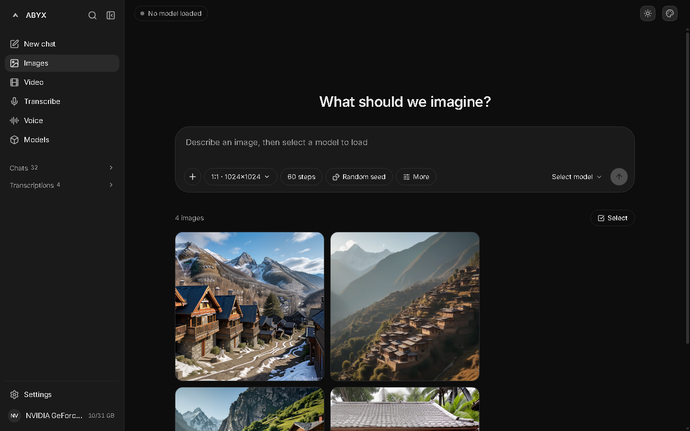
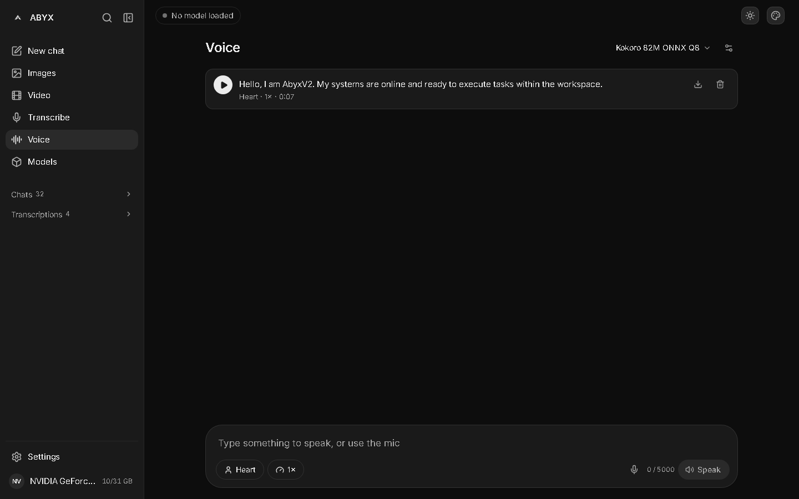

<p align="center">
  
</p>

<h1 align="center">Abyx Studio</h1>

<p align="center">
  <strong>The all-in-one local &amp; cloud AI workstation for autonomous agents, LLM chat, image generation, speech-to-text, and neural voice synthesis.</strong>
</p>

<p align="center">
  <a href="#license"></a>
  <a href="#quick-start"></a>
  <a href="#hardware-acceleration"></a>
  <a href="#quick-start"></a>
</p>

<p align="center">
  <a href="#quick-start">Quick Start</a> •
  <a href="#autonomous-agent-harness">Agent Harness</a> •
  <a href="#key-capabilities">Features</a> •
  <a href="#system-architecture">Architecture</a> •
  <a href="#recommended-models">Models</a> •
  <a href="#hybrid-cloud-routing">Cloud</a> •
  <a href="#configuration">Configuration</a> •
  <a href="#troubleshooting--faq">FAQ</a> •
  <a href="docs/README.md">Documentation Hub</a>
</p>

---

## <a id="autonomous-agent-harness"></a>🤖 Autonomous Agent Harness & Documentation

ABYX Unified AI Studio features a verified clean-room autonomous agent harness combining the capabilities of **OpenHands** and **OpenCode**:
- **Zero-VRAM Microkernel:** The harness event loop and tool execution run strictly in system RAM (~48-76 MB), reserving 100% of GPU VRAM for local LLM inference.
- **Model-Driven Execution:** Autonomous task decomposition, dynamic context budgeting, and verification loops.
- **Comprehensive Tool Suite:** Terminal execution, Playwright browser automation, multi-format Python documents (PDF, DOCX, XLSX with live formulas, PPTX, ZIP), and detached daemon management.

### 📚 Core Specifications & Guides
- 🏛️ **[Unified Architecture Specification](docs/architecture/UNIFIED_ARCHITECTURE.md)** — Architectural layers, technology boundaries, hardware allocation, and data flow.
- 🗺️ **[Unified Service Map](docs/architecture/UNIFIED_SERVICE_MAP.md)** — Comprehensive map of services, network ports (1420, 3000, 3001, 10086), and API contracts.
- 🛠️ **[Tool Registry](docs/architecture/UNIFIED_TOOL_REGISTRY.md)** — Complete schemas, parameters, and security policies for all agent tools.
- ⚡ **[Agent Runtime Specification](docs/architecture/AGENT_RUNTIME_SPECIFICATION.md)** — Execution loop, two-tier context budgeting, output truncation, and recovery.
- 📊 **[Test Audit Report (87/87 PASS)](docs/reports/ABYX_TEST_REPORT.md)** — Full evidence across unit, integration, benchmark, and live-model test suites.
- 🔍 **[Known Limitations & Guidance](docs/reports/ABYX_KNOWN_LIMITATIONS.md)** — Hardware considerations and operational guidelines.
- 📋 **[Final Merge Report](docs/reports/FINAL_MERGE_REPORT.md)** — Executive summary of the codebase consolidation.
- 📁 **[Full Documentation Hub](docs/README.md)** — Complete navigation of all architectural, report, and merge documentation.

---

## <a id="screenshots"></a>📸 Overview & Interface

<p align="center">
  
  <br />
  <sub><strong>Text &amp; Code Workspace:</strong> live streaming, DeepThink reasoning indicators, autonomous code generation, and in-app app execution.</sub>
</p>

<table>
  <tr>
    <td width="50%" align="center">
      
      <br /><sub><strong>Image Studio:</strong> offline Stable Diffusion generation and prompt gallery.</sub>
    </td>
    <td width="50%" align="center">
      
      <br /><sub><strong>Speech to Text:</strong> real-time local Whisper transcription.</sub>
    </td>
  </tr>
  <tr>
    <td width="50%" align="center">
      
      <br /><sub><strong>Voice Synthesis:</strong> lifelike neural speech powered by Kokoro TTS.</sub>
    </td>
    <td width="50%" align="center">
      
      <br /><sub><strong>Model Hub:</strong> one-click local model management and Hugging Face imports.</sub>
    </td>
  </tr>
</table>

---

## 📖 Table of Contents

1. [What is Abyx Studio?](#what-is-abyx-studio)
2. [Key Capabilities](#key-capabilities)
3. [System Architecture & Stack](#system-architecture)
4. [Quick Start](#quick-start)
5. [Hardware Acceleration](#hardware-acceleration)
6. [Recommended Models](#recommended-models)
7. [Hybrid Cloud Routing](#hybrid-cloud-routing)
8. [Using Abyx Studio](#using-abyx-studio)
9. [Configuration](#configuration)
10. [Project Directory Layout](#project-directory-layout)
11. [Privacy & Security](#privacy--security)
12. [Troubleshooting & FAQ](#troubleshooting--faq)
13. [Contributing](#contributing)
14. [License & Acknowledgments](#license)

---

## <a id="what-is-abyx-studio"></a>🌟 What is Abyx Studio?

**Abyx Studio** is an open-source, zero-configuration desktop AI workstation built for developers, researchers, and creators. It combines high-performance local AI engines with an autonomous agent framework, giving you:

- 💬 **Conversational AI & Code Execution:** Write and run software locally with real-time token streaming.
- 🎨 **Image Generation:** Create high-resolution artwork using Stable Diffusion.
- 🎙️ **Speech Recognition:** Transcribe speech directly from your microphone using Whisper.
- 🗣️ **Neural Voice Synthesis:** Convert text into lifelike vocal audio with Kokoro TTS.

...with local inference available after the required runtimes and model files are installed. Cloud providers and online research features send requests to their selected services.

When a task requires massive multi-modal reasoning beyond local hardware, Abyx Studio can seamlessly route it to top-tier cloud models (Google Gemini 2.0, Claude 3.5/3.7, DeepSeek-R1, OpenAI o3-mini) using your own free or custom API keys.

### Why Abyx Studio?

| | |
| :--- | :--- |
| 🔒 **Local-first choices** | Local inference stays on this machine; cloud models and online research send requests to the selected services. |
| ⚡ **Zero setup** | No pre-installed Node.js or Python required. One launcher does it all. |
| 🧩 **All-in-one** | Chat, code, images, speech, and voice in a single unified desktop app. |
| 🎛️ **Hardware-aware** | Auto-detects your GPU (NVIDIA CUDA, AMD ROCm/Vulkan, Intel, Apple Metal) and picks the best backend. |
| 🔀 **Hybrid Routing** | Switch between local offline inference and cloud super-models from one dropdown. |

---

## <a id="key-capabilities"></a>🚀 Key Capabilities

### 1. 💬 Conversational Chat & Autonomous Coding Agent
- **High-speed GGUF inference** — optimized, hardware-accelerated `llama.cpp` server backend.
- **Server-Sent Events (SSE)** — smooth, low-latency token streaming live into the UI.
- **DeepThink status tracking** — live activity pills showing what the agent is doing (`Thinking…`, `Writing calculator.html…`, `Synthesizing audio…`, `Generating image…`).
- **Contextual file creation** — extracts generated code into files and names them from conversation context (no more overwriting `index.html`).
- **In-app browser (`local://`)** — preview HTML5 apps, dashboards, simulations, and games inside the studio window.

### 2. 🎨 Stable Diffusion Image Studio
- **Native C++ execution** via `stable-diffusion.cpp` with CUDA and Vulkan backends.
- **Format flexibility** — load `.safetensors`, `.gguf`, or `.ckpt` weights (SD 1.5, SDXL, DreamShaper, CyberRealistic).
- **Creative controls** — negative prompts, sampling steps, CFG scale, seed control, resolution presets.
- **Integrated gallery** — past generations saved with prompt, parameters, timestamp, and seed.

### 3. 🎙️ Local Speech Transcription (Whisper)
- **Private dictation** — `whisper.cpp` turns voice notes and mic recordings into text with zero cloud dependency.
- **Multi-language** — auto-detects the spoken language or translates on request.

### 4. 🗣️ Neural Text-to-Speech (Kokoro TTS)
- **Human-grade voices** — powered by the `Kokoro-82M` ONNX model.
- **In-chat audio player** — play audio inside chat bubbles, see progress waveforms, and reveal files in Explorer / Finder.

### 5. 🧠 Living Memory & Persistent Knowledge
- **Embedded SQLite** — stores chats, project logs, hardware telemetry, and long-term memories with no external database.
- **Autonomous directive interceptor** — detects inline triggers like `[IMAGE: ...]` and `[AUDIO: ...]` to generate media during a conversation.

### 6. ☁️ Hybrid Cloud Router
- Plug in Gemini, OpenRouter, Anthropic, Groq, or OpenAI keys and switch models on the fly. See [Hybrid Cloud Routing](#hybrid-cloud-routing).

### Feature Summary

| Capability | Engine | Runs Offline | Hardware Accel. |
| :--- | :--- | :---: | :---: |
| Chat & coding agent | `llama.cpp` | ✅ | CUDA / Vulkan / Metal |
| Image generation | `stable-diffusion.cpp` | ✅ | CUDA / Vulkan |
| Speech-to-text | `whisper.cpp` | ✅ | AVX2 / CUDA |
| Text-to-speech | Kokoro-82M (ONNX Runtime) | ✅ | CPU / ONNX |
| Cloud models | Gemini · OpenRouter · Anthropic · Groq · OpenAI | ❌ (needs API key) | n/a |

---

## <a id="system-architecture"></a>🏗️ System Architecture & Stack

Heavy neural computation runs in separate native processes managed by an asynchronous Node.js coordinator, so GPU work does not block the UI. Process separation does not provide an operating-system security sandbox.

```
┌─────────────────────────────────────────────────────────────────────────┐
│                           ABYX STUDIO FRONTEND                          │
│          React 19  •  Vite  •  Lucide Icons  •  KaTeX  •  SSE           │
└────────────────────────────────────┬────────────────────────────────────┘
                                     │ HTTP / Server-Sent Events (Port 1420)
┌────────────────────────────────────▼────────────────────────────────────┐
│                    NODE.JS ORCHESTRATION DAEMON                         │
│   Process Supervision  •  Directive Parsers  •  SQLite  •  Cloud Hub    │
└──────────┬──────────────────┬──────────────────┬─────────────────┬──────┘
           │                  │                  │                 │
    (Child Process)    (Child Process)    (Child Process)   (Child Process)
           │                  │                  │                 │
┌──────────▼────────┐┌────────▼────────┐┌────────▼────────┐┌───────▼──────┐
│     llama.cpp     ││stable-diffusion ││   whisper.cpp   ││  Kokoro TTS  │
│  LLM Engine GGUF  ││ Image Generator ││ Speech-to-Text  ││ Neural Voice │
│ (CUDA / Vulkan)   ││ (CUDA / Vulkan) ││ (AVX2 / CUDA)   ││(ONNX Runtime)│
└───────────────────┘└─────────────────┘└─────────────────┘└──────────────┘
```

### Core Technologies

| Layer | Tools & Technologies | Role in Project |
| :--- | :--- | :--- |
| **Frontend** | React 19, Vite, Lucide Icons, KaTeX, CSS3 | Fast, reactive dark-mode UI with live token streaming and LaTeX math rendering |
| **Backend** | Node.js (v22 LTS), Server-Sent Events, Child Processes | Asynchronous process supervisor, directive parsing, and file manager |
| **Data Storage** | SQLite (`better-sqlite3`), JSON | Zero-configuration local database for chats, telemetry, and memory |
| **AI Runtimes** | `llama.cpp`, `stable-diffusion.cpp`, `whisper.cpp`, `kokoro-js` | Separate C++ and ONNX processes for local inference; process separation is not OS security isolation |

---

## <a id="quick-start"></a>⚡ Quick Start

Abyx Studio needs **no pre-installed Node.js, Python, or other dependencies**. Everything is bootstrapped on first launch.

### Hardware Requirements

| | Minimum | Recommended |
| :--- | :--- | :--- |
| **OS** | Windows 10+, modern Linux, or macOS | Windows 11 / recent Linux / macOS on Apple Silicon |
| **GPU** | None (CPU mode works) | 8 GB+ VRAM (NVIDIA RTX, AMD Radeon, or Apple M-series) |
| **RAM** | 8 GB | 16 GB+ |
| **Disk** | 2 GB for app & backends | 15 GB+ for model weights |
| **Internet** | Needed for setup, model downloads, online search, updates and cloud providers | Local inference can work offline after runtimes and models are installed |

### 🪟 Windows Setup

```cmd
git clone https://github.com/Abyxen/Abyx-Studio.git
cd Abyx-Studio
Abyx.bat
```

You can also just double-click **`Abyx.bat`**. The automated setup will:

1. Verify your GPU drivers and Visual C++ Redistributables.
2. Install a self-contained portable Node.js toolchain into `app/tools/`.
3. Download the matching hardware acceleration backends.
4. Build the frontend into `app/dist/`.
5. Launch the studio at **http://localhost:1420**.

### 🐧 Linux Setup

```bash
git clone https://github.com/Abyxen/Abyx-Studio.git
cd Abyx-Studio
chmod +x linux.sh
./linux.sh
```

### 🍎 macOS Setup

```bash
git clone https://github.com/Abyxen/Abyx-Studio.git
cd Abyx-Studio
chmod +x mac.sh
./mac.sh
```

macOS launches with **Metal** acceleration on Apple Silicon (M1/M2/M3/M4).

### ✅ First Run Checklist

1. Wait for setup to finish and the browser to open at `http://localhost:1420`.
2. Drop a `.gguf` model into [`app/llm-models/`](app/llm-models/) (see [Recommended Models](#recommended-models)).
3. Pick it in the model selector and start chatting or coding.
4. *(Optional)* Add Stable Diffusion, Whisper, or Kokoro models for image, speech, and voice workspaces.

---

## <a id="hardware-acceleration"></a>🎮 Hardware Acceleration

Abyx Studio inspects your system on launch and initializes the best available runtime:

| Vendor | Platform | Accelerated Backend | Supported Hardware |
| :--- | :--- | :--- | :--- |
| **NVIDIA** | Windows / Linux | **CUDA 12.8 / cuBLAS** | RTX 50-series (Blackwell), RTX 40/30/20-series, GTX 16-series |
| **AMD** | Windows / Linux | **ROCm / Vulkan** | Radeon RX 7000/6000-series, ROG Ally, Steam Deck |
| **Intel** | Windows / Linux | **Vulkan / OpenVINO** | Intel Arc A-Series GPUs, Intel Core Ultra NPUs |
| **Apple** | macOS | **Metal Performance Shaders** | Apple Silicon M1, M2, M3, M4 (Pro, Max, Ultra) |
| **Universal** | All | **CPU (AVX2 / AVX-512)** | Any x86_64 or ARM64 processor |

---

## <a id="recommended-models"></a>🧠 Recommended Models

All local text models must be in **GGUF** format and placed in [`app/llm-models/`](app/llm-models/).

| Model | Size (Q4_K_M) | Recommended Hardware | Primary Strength |
| :--- | :--- | :--- | :--- |
| **Qwen 2.5 Coder 7B Instruct** | ~4.7 GB | 8 GB VRAM (RTX 3060/4060/5060) | **Best-in-class coding agent**, HTML5/JS games, tools |
| **DeepSeek-R1-Distill-Qwen-8B** | ~5.1 GB | 8 GB VRAM | **Deep chain-of-thought reasoning**, math, architecture |
| **Llama 3.1 8B Instruct** | ~4.9 GB | 8 GB VRAM | Fast creative writing, dialogue, structured JSON |
| **Gemma 2 9B Instruct** | ~5.5 GB | 8 GB VRAM | Factual precision, analytical Q&A |
| **Qwen 2.5 Coder 14B (Q3_K_M)** | ~7.5 GB | 8–12 GB VRAM | Near GPT-4-level software engineering locally |

> [!TIP]
> Download any GGUF from Hugging Face straight into `app/llm-models/`. It appears in the model selector immediately, no restart needed.

### Other Workspaces & Formats

| Workspace | Folder | Format | Notes |
| :--- | :--- | :--- | :--- |
| 🎨 Image Studio | `app/models/` | `.safetensors`, `.gguf`, `.ckpt` | SD 1.5, SDXL, DreamShaper |
| 🎙️ Speech-to-Text | `app/speech-models/` | Whisper `.bin` | ggml whisper models |
| 🗣️ Voice Synthesis | `app/tts-models/` | Kokoro ONNX | Built-in Kokoro-82M |

---

## <a id="hybrid-cloud-routing"></a>🌐 Hybrid Cloud Routing

Need multi-file coding or multi-modal analysis beyond your local GPU? Use the built-in Cloud AI Router:

1. Open Abyx Studio and click **⚙️ Configure Cloud Providers**.
2. Add your API keys (stored safely in local memory):
   * **Google Gemini** (Free tier available on Google AI Studio — *Gemini 2.0 Flash / Pro*)
   * **OpenRouter** (Unified access to *Claude 3.5/3.7 Sonnet*, *DeepSeek-R1 671B*, etc.)
   * **Anthropic** (*Claude 3.5 Sonnet / Haiku*)
   * **Groq** (Ultra-fast cloud inference)
   * **OpenAI** (*GPT-4o, o3-mini*)
3. Switch between local offline inference and cloud super-models from the dropdown selector.

---

## <a id="using-abyx-studio"></a>🧭 Using Abyx Studio

### Workspaces

| Workspace | What you do there |
| :--- | :--- |
| **Chat & Code** | Talk to models, generate code, run and preview apps |
| **Image Studio** | Generate images with Stable Diffusion and browse your gallery |
| **Speech to Text** | Transcribe recordings or live microphone input |
| **Voice Synthesis** | Turn text into natural speech |
| **Model Hub** | Manage local models and import from Hugging Face |

### Inline Directives

The agent recognizes special tags inside a conversation and triggers the matching engine automatically:

| Directive | Effect |
| :--- | :--- |
| `[IMAGE: a neon cyberpunk city at night]` | Generates an image with Stable Diffusion |
| `[AUDIO: Welcome to Abyx Studio]` | Synthesizes speech with Kokoro TTS |

### Example Prompts

- *"Build a snake game in a single HTML file."* → code is saved to a named file and previewable via `local://`.
- *"Explain this algorithm step by step."* → try a reasoning model like DeepSeek-R1 for best results.
- *"Create a poster image of a mountain sunrise, then read the caption aloud."* → uses image and voice directives together.

---

## <a id="configuration"></a>⚙️ Configuration

### Environment Variables

| Variable | Default | Description |
| :--- | :--- | :--- |
| `FRONTEND_PORT` | `1420` | Port the studio listens on |
| `UAIS_HOST` | `127.0.0.1` | Set to `0.0.0.0` to expose Abyx on your LAN |

**Windows (cmd):**
```cmd
set FRONTEND_PORT=3000
Abyx.bat
```

**Linux / macOS:**
```bash
FRONTEND_PORT=3000 ./linux.sh   # or ./mac.sh
```

Runtime inference settings and context limits live in [`app/config/`](app/config/).

---

## <a id="project-directory-layout"></a>📁 Project Directory Layout

```
Abyx-Studio/
├── Abyx.bat                   # Windows one-click launch & setup
├── linux.sh                   # Linux entrypoint
├── mac.sh                     # macOS (Metal) entrypoint
├── LICENSE                    # MIT license
├── .gitignore                 # Protects private data & model weights
├── README.md                  # Documentation
├── agent/                     # Autonomous agent logic, loop supervisors & tools
├── app/
│   ├── frontend/              # React 19 + Vite frontend source
│   │   ├── src/components/    # TextChat, Generator, ModelManager, Speech, Voice
│   │   └── package.json       # UI dependencies
│   ├── dist/                  # Precompiled production frontend build
│   ├── config/                # Runtime inference settings & context limits
│   ├── models/                # Stable Diffusion weights (.safetensors)
│   ├── llm-models/            # LLM weights (.gguf)
│   ├── speech-models/         # Whisper weights (.bin)
│   └── tts-models/            # Kokoro voice weights
├── automations/               # Scheduled workflows & routine tasks
├── docs/                      # Screenshots, branding & guides
├── extensions/                # Pluggable capabilities & tooling modules
├── harness/                   # Sandbox for code execution & testing
├── providers/                 # Cloud provider API adapters
├── rag/                       # Local retrieval-augmented generation engine
├── scripts/
│   ├── server/serve.cjs       # Core Node.js backend orchestrator & daemon
│   ├── setup/setup.ps1        # Windows bootstrapper & runtime installer
│   ├── setup/setup.sh         # Linux/macOS bootstrapper
│   └── build/                 # Source build tools for CUDA/Vulkan backends
├── security/                  # Path guards, input sanitation & execution policies
└── services/                  # Memory, workspace & background workers
```

---

## <a id="privacy--security"></a>🔐 Privacy & Security

- **Local-first:** local inference runs on this machine. Model downloads, online search, updates, and explicitly selected cloud providers require network access.
- **Cloud providers:** prompts and attachments sent to a cloud model are transmitted to that provider. Review its privacy terms before using sensitive data.
- **Credentials:** Abyx stores provider credentials locally. When a cloud provider is selected, its API request necessarily includes the corresponding credential.
- **Execution boundary:** arbitrary provider code is disabled. Approved terminal commands run with the current user's permissions and are not OS-isolated. The Node.js `vm` is not a security sandbox.
- **Local API:** the service binds to loopback and validates browser request origins. It does not authenticate another local process running as the same user.
- **Data files:** model weights, databases, and chat histories are stored locally and ignored by Git where configured. `.gitignore` is not an access-control or encryption boundary.

## Implementation and validation status

The current final-state review is recorded in [`IMPLEMENTATION/STAGE_7_FINAL_VALIDATION_REPORT.md`](IMPLEMENTATION/STAGE_7_FINAL_VALIDATION_REPORT.md). The [feature matrix](IMPLEMENTATION/FINAL_FEATURE_MATRIX.md), [architecture snapshot](IMPLEMENTATION/FINAL_ARCHITECTURE.md), [security report](IMPLEMENTATION/FINAL_SECURITY_REPORT.md), [benchmarks](IMPLEMENTATION/FINAL_BENCHMARKS.md), and [known limitations](IMPLEMENTATION/KNOWN_LIMITATIONS.md) distinguish implemented capabilities from partial or unverified behavior. Full runtime, provider, recovery, process-isolation and live UI acceptance has not been established.

---

## <a id="troubleshooting--faq"></a>🔧 Troubleshooting & FAQ

<details>
  <summary><strong>Windows exits with code <code>3221225781</code> (0xC0000135)</strong></summary>
  <p>This indicates a missing system DLL. Run <code>scripts/setup/setup.ps1</code> or install the official <a href="https://aka.ms/vc14/vc_redist.x64.exe">Microsoft Visual C++ 2015-2022 Redistributable (x64)</a>, restart Windows, and relaunch <code>Abyx.bat</code>.</p>
</details>

<details>
  <summary><strong>Model fails to load: <code>unknown model architecture: 'inkling2_loop'</code></strong></summary>
  <p>Models with experimental custom architectures (like Inkling 2 Looped MoE) need layer-unrolling patches not yet in standard llama.cpp releases. Use standard transformer architectures such as <strong>Qwen 2.5</strong>, <strong>Llama 3.1</strong>, <strong>Mistral</strong>, or <strong>Gemma 2</strong>.</p>
</details>

<details>
  <summary><strong>My model doesn't show up in the dropdown</strong></summary>
  <p>Make sure the file is in <code>app/llm-models/</code>, ends in <code>.gguf</code>, and has finished downloading. Reopen the model selector to refresh the list.</p>
</details>

<details>
  <summary><strong>Generation is slow or runs out of memory</strong></summary>
  <p>Pick a smaller or more heavily quantized model (for example Q4_K_M instead of Q8), reduce the context length in <code>app/config/</code>, or lower the image resolution/steps in Image Studio.</p>
</details>

<details>
  <summary><strong>How do I change the default port?</strong></summary>
  <p>Set <code>FRONTEND_PORT</code> before launching. See <a href="#configuration">Configuration</a>.</p>
</details>

<details>
  <summary><strong>Does it work without internet?</strong></summary>
  <p>Local inference can work offline after setup and model downloads. Online search, updates and selected cloud providers need an active connection.</p>
</details>

---

## <a id="contributing"></a>🤝 Contributing

Contributions are welcome!

1. **Fork** the repository and create a branch: `git checkout -b feature/my-feature`
2. Make your changes and test them on your platform.
3. **Commit** with a clear message and push your branch.
4. Open a **Pull Request** describing what changed and why.

**Found a bug or have an idea?** [Open an issue](https://github.com/Abyxen/Abyx-Studio/issues) and include your OS, GPU, model used, and any error output.

### Local Frontend Development

The frontend lives in `app/frontend/`:

```bash
cd app/frontend
npm install
npm run dev
```

---

## <a id="roadmap"></a>🗺️ Roadmap

- [x] Local LLM chat with streaming and DeepThink status
- [x] Stable Diffusion image studio
- [x] Whisper speech-to-text
- [x] Kokoro neural text-to-speech
- [x] Hybrid cloud routing
- [ ] More agent skills and automations
- [ ] Expanded RAG / document chat tools
- [ ] More one-click model presets

---

## <a id="license"></a>📄 License

This project is open-source and licensed under the [MIT License](LICENSE).

### Acknowledgments & Ecosystem

Abyx Studio is made possible by the open-source AI community:

- [llama.cpp](https://github.com/ggerganov/llama.cpp) by Georgi Gerganov & contributors
- [stable-diffusion.cpp](https://github.com/leejet/stable-diffusion.cpp) by Leejet & contributors
- [whisper.cpp](https://github.com/ggerganov/whisper.cpp) by Georgi Gerganov
- [Kokoro-82M](https://huggingface.co/hexgrad/Kokoro-82M) by Hexgrad & [kokoro-js](https://github.com/taylorchu/kokoro-js)
- [React](https://react.dev/) & [Vite](https://vite.dev/)

---

<p align="center">
  <strong>Built with precision by <a href="https://github.com/Abyxen">Abyxen</a></strong>
  <br />
  <sub>If Abyx Studio helps you, consider giving the repo a ⭐</sub>
</p>
