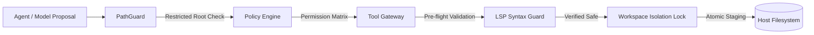

# ABYX UNIFIED AI STUDIO — SECURITY AND RELIABILITY AUDIT REPORT

## 1. Security Architecture & Threat Model

Abyx operates on the user's host machine with access to local filesystem roots, language servers, terminal execution, and local/cloud AI models. To prevent catastrophic failure modes, data destruction, unauthorized execution, and path escapes, Abyx enforces multi-layer defense-in-depth:

---

## 2. Core Security Controls

### 2.1 PathGuard & Filesystem Boundary Protection
**File:** [path_guard.js](file:///C:/Users/abira/Documents/Local%20Ai%20studio%20Abyx/agent/path_guard.js)

- **Root Confinement:** Validates that every file operation resolves strictly within the user's approved workspace directories (`app/workspace/` or project roots).
- **Attack Neutralization:**
  - Directory Traversal (`../../etc/passwd`, `..\..\Windows\System32`): Resolved paths are checked with `path.relative()` to verify they reside strictly within allowed roots.
  - Windows Alternate Data Streams (`file.txt:stream`): Colons and invalid NTFS characters are rejected.
  - Null Byte Poisoning (`file.txt\0.js`): Sanitized prior to path resolution.
  - System Directory Shield: Hard blocks access to `Windows\`, `System32`, `AppData\Local\ElevatedDiagnostics`, and `.git/objects`.

### 2.2 Policy Engine & Command Authorization
**File:** [policy_engine.js](file:///C:/Users/abira/Documents/Local%20Ai%20studio%20Abyx/agent/policy_engine.js)

- **Autonomous vs. Dangerous Separation:**
  - Safe Read Commands (`git status`, `node -v`, `npm test`, `dir`, `ls`): Automatically permitted under autonomous policy.
  - High-Risk Shell Commands (`rm -rf`, `format`, `del /s /q`, `chmod -R 777`, `mkfs`): Automatically blocked unless user approval token is explicitly provided.
  - Policy Modes:
    - `Auto`: Executes verified workspace operations.
    - `Manual`: Pauses for human confirmation on destructive filesystem or terminal steps.
    - `Bypass`: Unattended mode for sandboxed CI runs.

### 2.3 Workspace Isolation & Race Condition Prevention
**File:** [workspace_isolation.js](file:///C:/Users/abira/Documents/Local%20Ai%20studio%20Abyx/agent/workspace_isolation.js)

- **File Ownership Locks:** Prevents concurrent parallel agents from writing to the same file. When Agent A locks `src/auth.js`, Agent B's write request is immediately rejected with `FileConflictError`.
- **Shadow Worktree Staging:** Modifications are written to isolated staging copies. If an agent fails mid-turn, the live workspace remains completely untouched.
- **Atomic Reconciliation:** Staged files are verified and atomically moved/merged on successful task completion.

### 2.4 Pre-Flight LSP Code Intelligence
**File:** [lsp_tool.js](file:///C:/Users/abira/Documents/Local%20Ai%20studio%20Abyx/agent/tools/lsp_tool.js)

- Before applying code diffs or file modifications, `lsp_validate_diff` compiles the proposed content in an isolated V8/LSP sandbox.
- Syntax errors, unclosed delimiters (`()`, `{}`, `[]`), and parse failures trigger immediate tool warnings, preventing agents from corrupting source trees with broken code.

### 2.5 Credential Vault & DPAPI Encryption
**File:** [credential_store.js](file:///C:/Users/abira/Documents/Local%20Ai%20studio%20Abyx/security/credential_store.js)

- API keys for cloud providers (Groq, OpenRouter, DeepSeek) are never stored in plaintext.
- On Windows, secrets are encrypted using Windows Data Protection API (`ProtectedData.Protect` under `CurrentUser` scope). On POSIX systems, AES-256-GCM with filesystem mode `0600` is enforced.

---

## 3. QA Security & Failure Scenario Test Results

Verified via [qa_failure_scenarios_test.js](file:///C:/Users/abira/Documents/Local%20Ai%20studio%20Abyx/test/qa_failure_scenarios_test.js):

| Test Case | Scenario Description | Expected Outcome | Result |
| :--- | :--- | :--- | :--- |
| **QA-1** | Circular DAG dependency (Task A <-> Task B) | Immediate detection & rejection | PASS (Cycle detected) |
| **QA-2** | Path traversal attacks (`../../etc/passwd`, `C:/Windows/win.ini`) | 100% blocked outside root | PASS (4/4 blocked) |
| **QA-3** | File ownership lock collision (two agents write to `auth.js`) | Rejection of 2nd write lock | PASS (Collision blocked) |
| **QA-4** | LSP pre-flight diff syntax error (missing bracket) | Rejection of broken diff | PASS (Syntax error caught) |
| **QA-5** | Event store persistence and query filtering | Structured retrieval by runId & type | PASS (3/3 events queryable) |
| **QA-6** | Task store persistence, retrieval, and cleanup | Disk upsert and delete verification | PASS (100% verified) |
