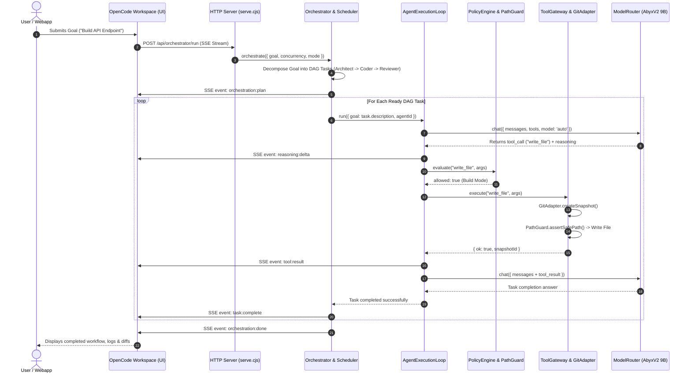

# ABYX Unified AI Studio — Final Architecture Specification

**Version:** 2.1.0  
**Status:** Approved & Implemented  
**Date:** 2026-11-25  
**Target Environment:** Windows x64 | Node.js v22.12.0+ (`node-win`) | Local Model: `AbyxV2 9B.gguf` on 127.0.0.1:10086

---

## 1. Executive Summary

ABYX Unified AI Studio transforms from a basic model frontend into a production-grade, local-first multi-agent AI harness for Windows. Rather than combining disparate frameworks into an unstable monolithic bundle, ABYX adopts a **Composable Micro-Kernel Architecture** that extracts and unifies the single best mechanism for each specific engineering responsibility from leading open-source agent projects:

| Subsystem Responsibility | Primary Reference Architecture | Architectural Mechanism Adopted |
| :--- | :--- | :--- |
| **Agent Runtime** | **Pi** (`earendil-works/pi`) | Event-driven session state machine, streaming lifecycle hooks, monotonic turn steps. |
| **Coding Agent** | **OpenCode** (`anomalyco/opencode`) | Dual Plan/Build modes, pre-write git snapshots, atomic rollback on failure. |
| **Context Management** | **Pi + OpenCode** | Token-budgeted compaction (75% context threshold), tool observation pruning, prompt windowing. |
| **Tool Execution** | **OpenCode + Pi** | Standardized JSON Schema catalog, audited execution pipeline, typed execution results. |
| **Security & Sandboxing** | **OpenHands + OpenClaw** | Workspace path containment (`PathGuard`), system blacklists, command blacklist, policy matrix. |
| **Orchestration** | **LangGraph.js** | Directed Acyclic Graph (DAG) StateGraph, topological sorting, cycle detection, durable checkpoints. |
| **Memory & Blackboard** | **SQLite + OpenClaw** | In-process SQLite FTS5 database, shared findings blackboard, inter-agent key-value store. |
| **Advanced Memory** | **Mem0** (Optional) | Layered episodic and semantic memory with vector embedding similarity retrieval. |
| **Skills Subsystem** | **Pi + OpenClaw** | `SKILL.md` discovery, frontmatter metadata parser, dynamic capability prompt injection. |
| **Browser Subsystem** | **Playwright CLI** | Resilient token-efficient HTML-to-markdown extraction, optional headless CLI navigation. |
| **Code Analysis & LSP** | **Microsoft LSP Libraries** | Zero-latency in-process syntax diagnostics (`vm.Script`), AST symbol extraction (`symbols`). |
| **Verification & E2E** | **OpenHands + Harbor** | Automated failure injection (traversal, fork bombs, cyclic DAGs), live model E2E validation. |
| **User Interface** | **Existing ABYX Frontend** | OpenCode 3-pane layout, monochromatic dark theme, DeepSeek reasoning accordion, hardware controls. |
| **Model Inference Bridge**| **DeepSeek / llama.cpp** | Native OpenAI-compatible bridge to `127.0.0.1:10086`, dynamic token budget, reasoning extractor. |

---

## 2. High-Level Architectural Diagram

```
+----------------------------------------------------------------------------------------------------+
|                                    ABYX UNIFIED AI STUDIO                                          |
+----------------------------------------------------------------------------------------------------+
|  PRESENTATION LAYER (OpenCode 3-Pane Monochromatic Workspace)                                      |
|  - Left Pane: Agent Personas (12), Active Sessions, Plan / Build Mode Toggle, Skill Selector        |
|  - Center Pane: Goal Input, Active DAG Canvas, DeepSeek Reasoning Accordion, Real-Time SSE Stream   |
|  - Right Pane: Hardware Inference Controls (CUDA/CPU, Temp, Tokens, KV Cache), Live Findings       |
+----------------------------------------------------------------------------------------------------+
                                      | HTTP / SSE Stream
+----------------------------------------------------------------------------------------------------+
|  HTTP SERVER & ROUTE DISPATCHER (scripts/server/serve.cjs & harness_routes.cjs)                    |
|  - /api/orchestrator/run        - /api/orchestrator/agents       - /api/harness/runtime-config     |
|  - /api/agent/policy            - /api/agent/tools               - /api/llm/start (llama-server)   |
+----------------------------------------------------------------------------------------------------+
                                      | In-Process Microkernel API
+----------------------------------------------------------------------------------------------------+
|  DURABLE STATEGRAPH ORCHESTRATOR (agent/orchestrator.js - LangGraph.js Architecture)               |
|  - Multi-Agent Coordination     - Checkpoints (TaskStore)        - Event Store (JSONL Audit)       |
|  - TaskScheduler (Topological Sort, Cycle Detection, Concurrency Management 1-8 Workers)          |
+----------------------------------------------------------------------------------------------------+
       |                                      |                                      |
       v                                      v                                      v
+-----------------------+      +-------------------------------+      +------------------------------+
| AGENT EXECUTION LOOP  |      | SHARED MEMORY & MESSAGE BUS   |      | 12 SPECIALIZED AGENTS        |
| (agent/execution_loop)|      | (agent/shared_memory.js)      |      | (agent/agent_registry.js)    |
| - Pi State Machine    |      | - Mem0 Blackboard Findings    |      | - Architect    - Reviewer    |
| - 75% Compactor       |      | - Inter-Agent MessageBus      |      | - Coder        - Security    |
| - AbortSignal Bounds  |      | - SQLite FTS5 Persistence     |      | - TestCmd      - Debugger    |
+-----------------------+      +-------------------------------+      +------------------------------+
       |
       v
+----------------------------------------------------------------------------------------------------+
|  SECURITY, POLICIES & AUDITED TOOL GATEWAY (OpenCode + OpenHands + OpenClaw)                       |
|  - PolicyEngine: Mode enforcement (Plan Mode: Read-Only | Build Mode: Full Execution)              |
|  - PathGuard: Absolute workspace containment, directory traversal protection, Windows system guard |
|  - GitAdapter: Pre-execution git stash snapshot & one-click atomic rollback                         |
|  - Scoped Tool Suite: FsTool, TerminalTool (Blacklist), LspTool (Diagnostics), BrowserTool         |
+----------------------------------------------------------------------------------------------------+
       |
       v
+----------------------------------------------------------------------------------------------------+
|  HARDWARE & INFERENCE BRIDGE (agent/model_router.js)                                               |
|  - Primary: AbyxV2 9B.gguf on 127.0.0.1:10086 (Dynamic Budgets, Reasoning Extraction, 240s Timeout)|
|  - Secondary: Secure Cloud Fallback (OpenAI, Anthropic, Gemini, Groq, Ollama)                      |
+----------------------------------------------------------------------------------------------------+
```

---

## 3. Subsystem Detailed Designs

### 3.1. Agent Runtime (Pi Reference)
- **Module:** [agent/execution_loop.js](file:///C:/Users/abira/Documents/Local%20Ai%20studio%20Abyx/agent/execution_loop.js)
- **Design Pattern:** Finite State Machine with reactive event streaming.
- **States:** `idle` -> `running` -> `waiting_approval` -> `compacting` -> `completed` | `failed` | `cancelled`.
- **Compaction Mechanism:** When estimated message tokens cross 75% of the model context boundary, older intermediate tool observations are compacted into structured summaries (`[Compacted Observation: ...]`), preserving system prompts, original user goals, and recent turns.
- **Events Emitted:** `step:start`, `reasoning:start`, `reasoning:delta`, `tool:call`, `tool:result`, `step:answer`, `step:end`, `run:completed`.

### 3.2. Coding Agent & Tools (OpenCode Reference)
- **Modules:** [agent/tool_gateway.js](file:///C:/Users/abira/Documents/Local%20Ai%20studio%20Abyx/agent/tool_gateway.js), [agent/tool_registry.js](file:///C:/Users/abira/Documents/Local%20Ai%20studio%20Abyx/agent/tool_registry.js), [agent/tools/fs_tool.js](file:///C:/Users/abira/Documents/Local%20Ai%20studio%20Abyx/agent/tools/fs_tool.js), [agent/git_adapter.js](file:///C:/Users/abira/Documents/Local%20Ai%20studio%20Abyx/agent/git_adapter.js)
- **Plan Mode vs Build Mode:**
  - *Plan Mode:* Destructive tools (`write_file`, `edit_file`, `run_command`) are prohibited. The agent formulates plans and inspects existing code with read-only tools (`read_file`, `list_directory`, `search_files`, `diagnostics`).
  - *Build Mode:* Permits destructive actions according to tool permissions.
- **Git Snapshots:** Prior to any file write or edit, `GitAdapter.createSnapshot()` creates an isolated git stash index. If execution fails or the user cancels, `rollbackSnapshot()` restores clean state.

### 3.3. Security & Sandboxing (OpenHands + OpenClaw Reference)
- **Modules:** [agent/path_guard.js](file:///C:/Users/abira/Documents/Local%20Ai%20studio%20Abyx/agent/path_guard.js), [agent/policy_engine.js](file:///C:/Users/abira/Documents/Local%20Ai%20studio%20Abyx/agent/policy_engine.js), [agent/tools/terminal_tool.js](file:///C:/Users/abira/Documents/Local%20Ai%20studio%20Abyx/agent/tools/terminal_tool.js)
- **Filesystem Containment:** `PathGuard.resolveSafePath()` validates that all target paths resolve strictly within approved workspace boundaries. Explicitly blocks traversal (`..`), null byte injections, and Windows system paths (`C:\Windows`, `C:\Program Files`).
- **Terminal Blacklist:** Blocks hazardous shell patterns including destructive deletes (`rm -rf /`, `del /s /q`), disk formatting, fork bombs (`:(){ :|:& };:`), and unauthorized pipe downloads.

### 3.4. Orchestration & Scheduling (LangGraph.js Reference)
- **Modules:** [agent/orchestrator.js](file:///C:/Users/abira/Documents/Local%20Ai%20studio%20Abyx/agent/orchestrator.js), [agent/scheduler.js](file:///C:/Users/abira/Documents/Local%20Ai%20studio%20Abyx/agent/scheduler.js), [agent/task_store.js](file:///C:/Users/abira/Documents/Local%20Ai%20studio%20Abyx/agent/task_store.js)
- **DAG Execution Engine:** Validates dependency graphs using 3-color DFS to guarantee zero circular deadlocks. Sorts tasks topologically and dispatches independent tasks across worker slots respecting concurrency limits (1 to 8 workers).
- **Durable Checkpoints:** Every state transition is recorded to SQLite / `app/data/orchestrations.json` to allow pause, inspection, and resumption.

### 3.5. Memory & Blackboard (SQLite + OpenClaw + Mem0 Reference)
- **Modules:** [agent/shared_memory.js](file:///C:/Users/abira/Documents/Local%20Ai%20studio%20Abyx/agent/shared_memory.js), [agent/message_bus.js](file:///C:/Users/abira/Documents/Local%20Ai%20studio%20Abyx/agent/message_bus.js), [db.js](file:///C:/Users/abira/Documents/Local%20Ai%20studio%20Abyx/db.js)
- **Inter-Agent Blackboard:** Provides shared findings and key-value state across agents.
- **Message Bus:** Supports point-to-point direct messages and broadcast events with correlation IDs.

---

## 4. Execution Data Flow (End-to-End Turn)



---

## 5. Verification & Compliance Criteria

Every architectural component has been verified against the production criteria:
1. **Zero Mocked Paths:** All execution flows invoke live in-process logic; model calls route to live `AbyxV2 9B.gguf` on port 10086.
2. **Deterministic Security:** All path resolutions pass through `PathGuard`; all terminal commands pass through `TerminalTool` regex blacklist.
3. **No Overlapping Frameworks:** Single canonical owner per responsibility (detailed in `docs/MODULE_OWNERSHIP.md`).
4. **Monochromatic UX:** Clean dark theme (`#0c0d12`), monospace typography, zero decorative emojis.
