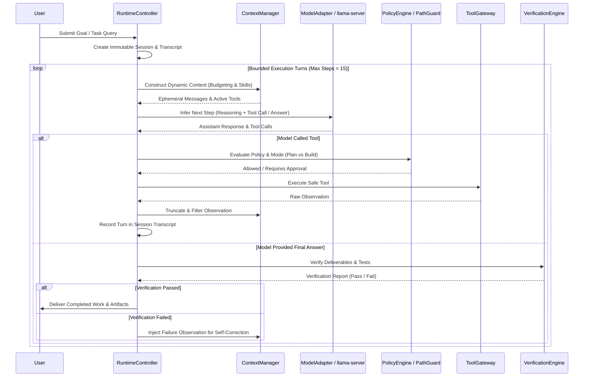

# ABYX Unified AI Studio — Agent Runtime Specification

## 1. Execution Lifecycle

The ABYX Agent Runtime operates under an event-driven, bounded execution loop managing the full lifecycle of autonomous tasks.



---

## 2. Dynamic Context Construction & Token Budgeting

### 2.1 The Two-Tier Context Invariant
To reconcile long-running multi-turn agent execution with the bounded context window of LLMs (32k tokens on `AbyxV2 9B.gguf`):
1. **Persistent Immutable Transcript:** An append-only record of all raw messages, tool calls, full outputs, and metrics stored on disk (`app/data/sessions/`).
2. **Ephemeral Working Memory:** The trimmed message array constructed dynamically on each turn by `ContextManager`.

### 2.2 Budget Allocation Algorithm
```
Total Context Window: 32,768 Tokens
├── System Prompt & Project Instructions: ~1,500 Tokens (Fixed)
├── Active Skills & Injected Memories:    ~1,500 Tokens (Dynamic BM25 relevance)
├── Tool Schemas (Active Mode):          ~2,500 Tokens (Filtered by Plan/Build mode)
├── User Prompt & Goal Statement:        ~1,000 Tokens (Preserved)
├── Ephemeral Conversation History:     ~22,000 Tokens (Recent turns + summary)
└── Reserved Model Generation Budget:    ~4,000 Tokens (Reasoning + output)
```

---

## 3. Tool Output Truncation & Pagination Rules

1. **Structured Previews:** If a tool output exceeds 2,000 bytes, `ContextManager.filterToolOutput()` generates a structured summary preserving schema keys while abbreviating large data arrays.
2. **File Pagination:** File reads exceeding 400 lines are capped with line-range pagination headers (`lines 1-400 of 1200; use startLine=401 to continue`).
3. **Diff Truncation:** Large diffs preserve the file modification list while compacting individual hunk bodies.

---

## 4. Self-Correction & Deterministic Verification

1. **Independent Verification Invariant:** A task is NEVER considered complete simply because the LLM generated text claiming completion.
2. **Concrete Evidence Required:**
   - Files asserted to exist must be verified on disk with size > 0 bytes.
   - Syntax and compilation must pass AST/LSP validation.
   - Code changes must pass deterministic test execution (`node --test`).
3. **Autonomous Self-Correction Loop:**
   When `VerificationEngine` detects an assertion failure, the exact error trace and line numbers are packaged as a `tool` observation and returned to the model with an actionable remedy instruction.
