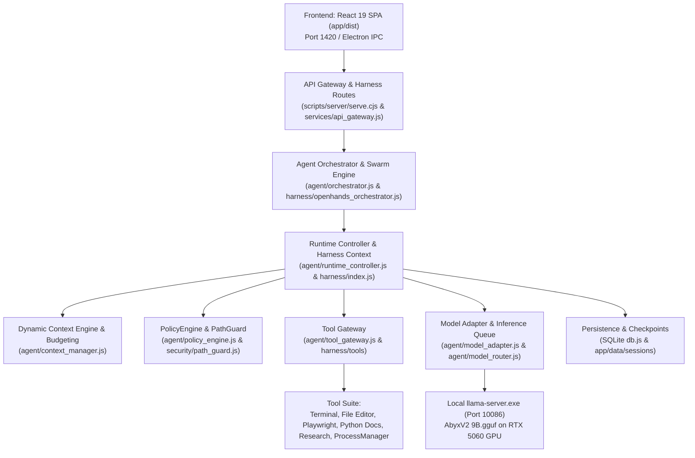

# ABYX Unified AI Studio — Unified Architecture Specification

## 1. Executive Summary & Technology Boundaries

ABYX Unified AI Studio is a unified autonomous AI agent environment and engineering studio operating entirely within ONE canonical root directory:
`C:\Users\abira\Documents\Local Ai studio Abyx`

The architecture merges the verified behavior of OpenHands and OpenCode with the desktop runtime of ABYX:
- **Desktop Shell:** Electron 39 desktop container with window lifecycle, native menus, and tray management (`electron/main.js`).
- **Interactive UI:** React 19 single-page application compiled to `app/dist/`, featuring agent swarms, terminal emulation, timeline viewers, diff visualizers, and memory explorers.
- **Microkernel Backend:** Native Node.js HTTP/SSE/WebSocket server (`scripts/server/serve.cjs`, `services/api_gateway.js`, `services/websocket_server.js`) on ports 1420 / 3000 / 3001.
- **Persistence Engine:** Zero-dependency SQLite database (`db.js`, `db_migrations.js`) managing user profiles, chat conversations, episodic memories, and session checkpoints.
- **Model Inference Engine:** Local `llama-server.exe` (port 10086) hosting `AbyxV2 9B.gguf` on the dedicated NVIDIA GeForce RTX 5060 Laptop GPU (~5.9 GB VRAM, 32k context) with cloud fallback capabilities (Groq, OpenAI, Anthropic, Gemini).
- **Harness & Tool Execution:** Zero-VRAM microkernel harness (`harness/`, `agent/`) controlling planning, tool execution, output filtering, and verification.

---

## 2. Multi-Layer Technology Architecture

---

## 3. Technology Choices & Design Invariants

### 3.1 Zero-VRAM Overhead for Agent Harness
- **Constraint:** The local model (`AbyxV2 9B.gguf`) requires ~5.9 GB of the 8.0 GB VRAM available on the RTX 5060 Laptop GPU.
- **Implementation:** The entire ABYX agent harness, event loop, tool gateway, context manager, and document converters execute exclusively on the CPU and system RAM (~48-76 MB footprint). Zero GPU memory is consumed by the harness, preserving 100% of available VRAM for local LLM inference and deep thinking tokens.

### 3.2 Model-Driven Autonomous Loop (No Hardcoded Sequences)
- Agent actions, tool invocations, and plan revisions are strictly generated by the LLM via OpenAI-compatible tool calling or structured JSON reasoning extraction.
- The harness enforces state transitions (Plan Mode vs. Build Mode, Design -> Implementation -> Verification) through deterministic gates without pre-scripting task solutions.

### 3.3 Ephemeral Working Messages vs. Immutable Transcript
- To prevent context overflow on long sessions, working message arrays undergo dynamic budgeting, tool output truncation, and semantic compression.
- Concurrently, an append-only JSON transcript preserves the complete history, tool arguments, raw outputs, and execution metrics for offline evaluation and auditability.

### 3.4 Multi-Tool Execution Ecosystem
- **File System Primitives:** `smart_file_editor`, `read_file`, `write_file`, `patch_file`, `diff_files` with strict canonical path traversal validation (`PathGuard`).
- **Terminal Execution:** Workspace-constrained shell execution with execution timeouts, exit code tracking, and dangerous command blacklisting.
- **Browser Automation:** Headless Chromium automation via Playwright for DOM extraction, screenshots, navigation, and form interaction.
- **Document Suite:** Production Python engine (`services/python_doc_tools.py`) generating binary ReportLab PDFs, python-pptx presentations, openpyxl spreadsheets with live formula calculation, and cryptographic SHA-256 ZIP bundles.
- **Background Processes:** Detached execution manager (`ProcessManager`) managing daemons (e.g., `llama-server.exe`) with log streaming and PID lifecycle control.

---

## 4. Hardware Calibration & Concurrency Model

| Subsystem | Execution Location | Resource Allocation | Concurrency / Limits |
| :--- | :--- | :--- | :--- |
| `llama-server.exe` | RTX 5060 Laptop GPU | ~5.9 GB VRAM, 99 layers offloaded | 1 serialized inference queue |
| Agent Engine | CPU (Node.js v26) | ~48-76 MB RAM, 0 MB VRAM | Up to 15 concurrent subagents |
| React UI / Electron | Chromium / GPU Accel | ~120 MB RAM | Single-process window |
| Document Engine | Python 3.15 runtime | On-demand CPU process | Isolated sub-processes |
| Playwright Chromium | Headless browser | ~150 MB RAM | Transient sandbox instances |
